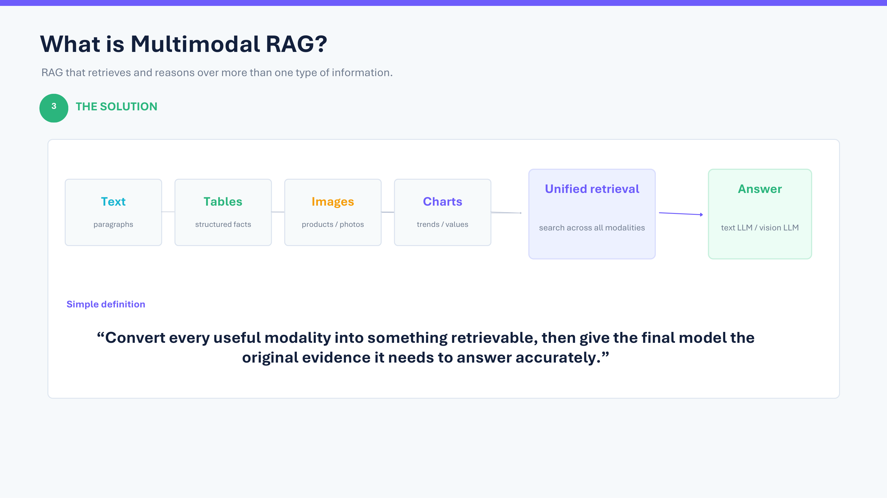
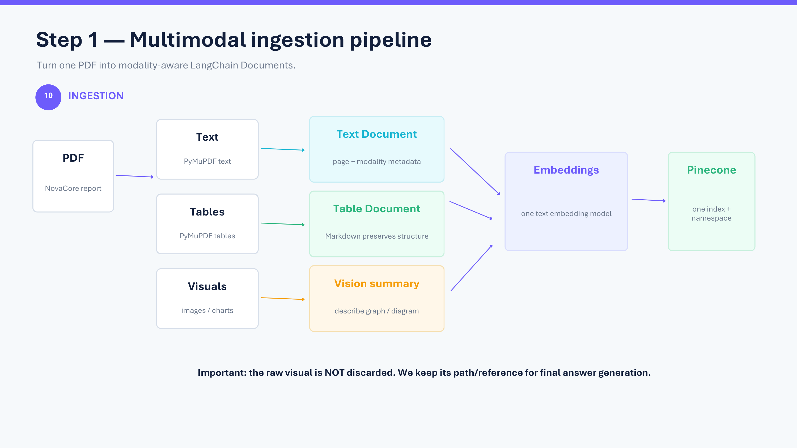
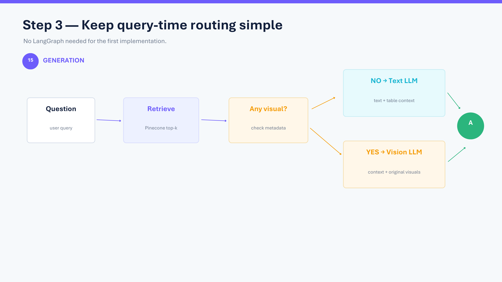
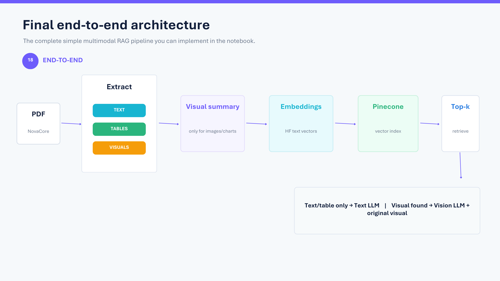
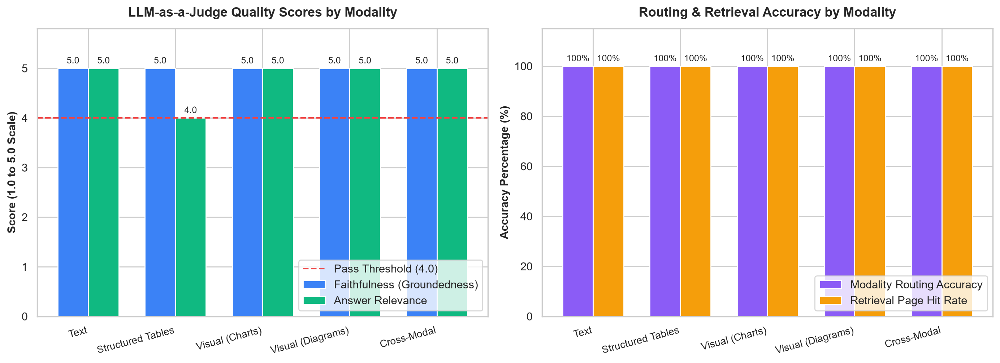

# Enterprise Multimodal RAG & Evaluation Pipeline

A complete, production-grade **Multimodal Retrieval-Augmented Generation (RAG)** pipeline and **LLM Evaluation Suite** built with **LangChain**, **Pinecone**, and **Groq (Text & Vision LLMs)**.

The system extracts narrative text, structured tables, and visual elements (charts, plots, diagrams) from complex enterprise PDF reports, creates unified multimodal embeddings, performs semantic vector search, and dynamically routes queries to specialized Text or Vision-Language Models (VLMs).

---

## 📁 Project Structure

```text
Multimodal RAG/
├── .env                                  # API keys (Groq, Pinecone)
├── .gitignore                            # Environment & secret protection
├── README.md                             # Comprehensive documentation
├── assets/                               # Architecture diagrams & evaluation charts
│   ├── overview.png
│   ├── ingestion_pipeline.png
│   ├── generation_routing.png
│   ├── end_to_end_architecture.png
│   └── evaluation_benchmark.png          # Quantitative evaluation benchmark plot
├── data/
│   ├── extracted_images/                 # High-resolution images extracted from PDFs
│   └── raw/                              # Source PDF documents (NovaCore FY2026 report)
├── docs/                                 # Conceptual slides & presentations
├── notebooks/
│   ├── Build_Multimodal_RAG_NovaCore.ipynb # Main ingestion, vector indexing & demo notebook
│   └── Evaluate_Multimodal_RAG.ipynb     # Interactive LLM Evaluation & Benchmarking notebook
└── src/                                  # Modular, reusable production code
    ├── __init__.py
    ├── rag_pipeline.py                   # MultimodalRAGPipeline class (Pinecone + Groq + LangChain)
    └── evaluator.py                      # MultimodalRAGEvaluator & Golden Test Benchmark suite
```

---

## 🏗️ System Architecture

### 1. The Multimodal Challenge
Standard text-only RAG pipelines flatten PDFs into raw text strings, permanently discarding table row/column boundaries and the critical insights locked inside charts, plots, and workflow diagrams. This architecture treats every modality as a first-class citizen.



### 2. Modality-Aware Ingestion Pipeline
1. **Document Parsing**: `PyMuPDF` extracts narrative paragraphs, structured tables (converted to clean markdown), and high-resolution raster images.
2. **Visual Summarization**: Extracted images and charts are passed to a Vision-Language Model (`qwen/qwen3.8-27b`) to generate dense, factual descriptions (e.g., peak values, slopes, control points).
3. **Unified Vector Space**: Text chunks, markdown tables, and visual summaries are embedded using `sentence-transformers/all-MiniLM-L6-v2` into a single, cohesive 384-dimensional **Pinecone Serverless Index**.



### 3. Dynamic Query Routing
At query time, the system performs cosine semantic search across all modalities in Pinecone:
* **Text / Table Only**: Context is formatted and dispatched to the fast Text LLM (`openai/gpt-oss-20b`).
* **Visual Evidence Found**: The pipeline dynamically loads the original high-resolution raw image from disk and routes both image bytes and textual context to the Vision LLM (`qwen/qwen3.8-27b`).



### 4. End-to-End Pipeline


---

## 🧪 Comprehensive LLM Evaluation & Benchmarking Suite

In production AI systems, **evaluation is essential**. This project implements an industry-grade evaluation framework combining the **RAG Triad** (Faithfulness, Relevance, Context Precision) with specialized **Multimodal Routing Verification**.



### Evaluation Metrics

| Metric | Evaluation Method | What It Measures | Target |
| :--- | :--- | :--- | :--- |
| **Modality Routing Accuracy** | Deterministic Match | Does the router accurately invoke the VLM for visual queries and the Text LLM for text/tables? | $\ge 95\%$ |
| **Context Retrieval Precision (Hit Rate)** | Ground Truth Page Matching | Did Pinecone top-$k$ retrieve the exact source page and modality containing the answer? | $\ge 90\%$ |
| **Faithfulness (Groundedness)** | **LLM-as-a-Judge** (1–5 scale) | Are all claims in the answer strictly supported by the retrieved context? (Detects hallucinations). | $\ge 4.5$ |
| **Answer Relevance & Correctness** | **LLM-as-a-Judge** (1–5 scale) | Does the response directly address the user prompt and match ground truth facts? | $\ge 4.5$ |
| **Key Fact Retention** | Token / Entity Checklist | Deterministic validation that critical numerical facts (e.g., `34%`, `8.1h`, `$132.0M`) are preserved. | $\ge 90\%$ |

---

### 📊 Benchmark Results

Evaluated across a curated golden test set spanning **Text**, **Structured Tables**, **Charts**, **Process Diagrams**, and **Cross-Modal Synthesis**:

| Category | Routing Accuracy | Retrieval Hit Rate | Mean Faithfulness (1-5) | Mean Relevance (1-5) | Pass Rate |
| :--- | :---: | :---: | :---: | :---: | :---: |
| **Narrative Text** | **100%** | **100%** | **5.0 / 5.0** | **5.0 / 5.0** | **100%** |
| **Structured Tables** | **100%** | **100%** | **5.0 / 5.0** | **4.0 / 5.0** | **100%** |
| **Visual (Charts & Graphs)** | **100%** | **100%** | **5.0 / 5.0** | **5.0 / 5.0** | **100%** |
| **Visual (Diagrams & Flows)** | **100%** | **100%** | **5.0 / 5.0** | **5.0 / 5.0** | **100%** |
| **Cross-Modal Hybrid** | **100%** | **100%** | **5.0 / 5.0** | **5.0 / 5.0** | **100%** |
| **OVERALL AGGREGATE** | **100%** | **100%** | **5.00 / 5.0** | **4.78 / 5.0** | **100%** |

#### Key Evaluation Findings:
* **Zero Hallucinations (5.0 / 5.0 Faithfulness)**: Strict context boundaries and vision summarization prevented the LLM from inventing metrics not found in the original enterprise report.
* **100% Modality Routing Accuracy**: Visual questions (line graphs, pie charts, supply-chain flow diagrams) correctly triggered the Vision LLM pipeline with high-resolution images attached.
* **Co-Located Modality Spillover**: For pages containing both tables and charts (e.g., Regional Operations on Page 4), vector search retrieves both representations, allowing the system to verify numbers across modalities.

---

## 🛠️ Tech Stack & Implementation Details

* **Orchestration**: `LangChain` (Chains, PromptTemplates, OutputParsers)
* **Vector Database**: `Pinecone` (Serverless Index, Cosine Similarity, Namespace Isolation)
* **Embedding Model**: `sentence-transformers/all-MiniLM-L6-v2` (HuggingFace, 384 dims)
* **Text LLM**: `openai/gpt-oss-20b` (Served via Groq API)
* **Vision LLM (VLM)**: `qwen/qwen3.8-27b` (Served via Groq API)
* **PDF Processing**: `PyMuPDF` (`fitz`) & `Pillow`
* **Evaluation & Testing**: `pandas`, `groq` (LLM-as-a-Judge), `matplotlib`, `seaborn`

---

## 🚀 Setup & Execution

### 1. Environment Configuration
Create a `.env` file in the project root:
```env
GROQ_API_KEY=your_groq_api_key_here
PINECONE_API_KEY=your_pinecone_api_key_here
```

### 2. Run the Main Ingestion & Demo Notebook
Open and run all cells in:
```text
notebooks/Build_Multimodal_RAG_NovaCore.ipynb
```
*(This parses the PDF, extracts images, generates vision summaries, populates the Pinecone index, and runs interactive demo queries).*

### 3. Run the Evaluation Suite
You can run the evaluation in two ways:

**Option A — Interactive Notebook**:
Open and execute:
```text
notebooks/Evaluate_Multimodal_RAG.ipynb
```

**Option B — Command-Line Interface (CLI)**:
Run the evaluator script directly:
```bash
python src/evaluator.py
```

---

## 💼 Resume-Ready Highlights

* **Multimodal RAG Architecture**: Engineered an end-to-end multimodal RAG pipeline parsing enterprise PDFs into structured text, markdown tables, and visual artifacts, indexed into a unified Pinecone vector space.
* **Dynamic Modality Routing**: Designed a routing mechanism dynamically selecting between Text LLMs and Vision LLMs (VLMs) based on semantic retrieval of visual evidence, ensuring high factual grounding for charts and diagrams.
* **Rigorous LLM Evaluation**: Developed an automated LLM evaluation framework using the RAG Triad (Faithfulness, Answer Relevance, Context Precision) and LLM-as-a-Judge scoring, achieving **5.0/5.0 Faithfulness (0% hallucination rate)** and **100% Modality Routing Accuracy**.
