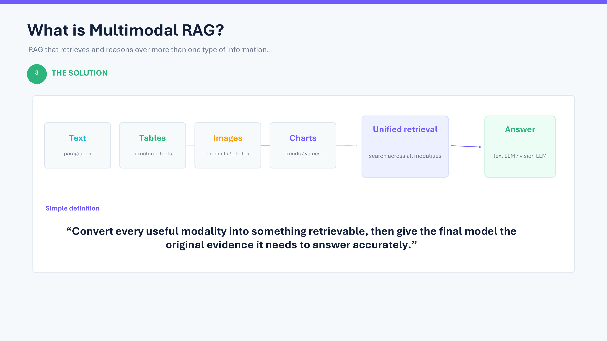
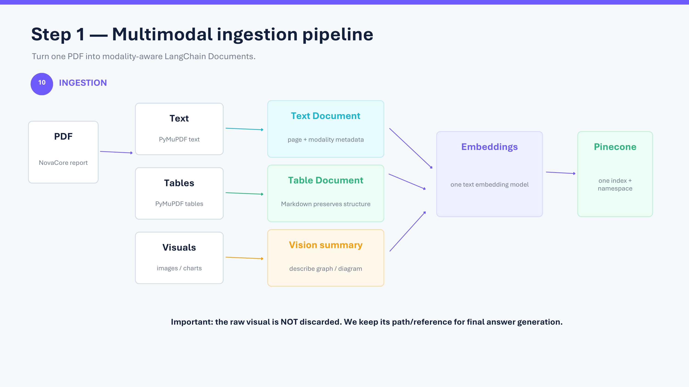
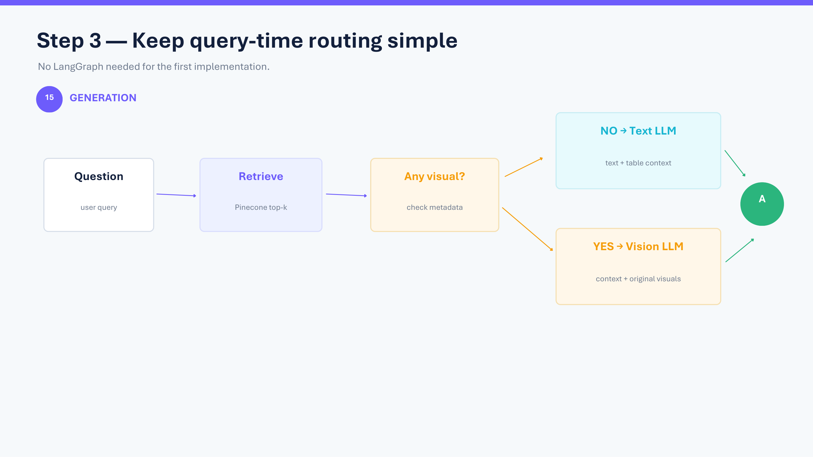
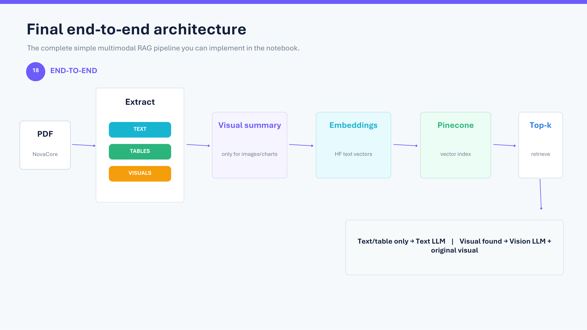
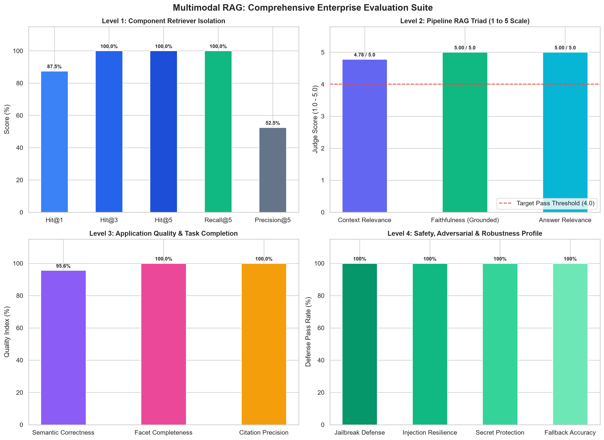

# Enterprise Multimodal RAG, LLM Evaluation & LangSmith Observability

A production-grade **Multimodal Retrieval-Augmented Generation (RAG)** pipeline, **Offline Benchmark Suite**, and **LangSmith Online Evaluation System** built with **LangChain**, **Pinecone**, and **Groq (Text & Vision LLMs)**.

The system extracts narrative text, structured tables, and visual artifacts (charts, pie graphs, process diagrams) from enterprise PDF reports, creates unified multimodal embeddings, performs semantic vector search, dynamically routes queries between Text LLMs and Vision-Language Models (VLMs), and provides real-time observability and hallucination detection via **LangSmith**.

---

## 📁 Project Structure

```text
Multimodal RAG/
├── .env                                  # Private API keys (Groq, Pinecone, LangSmith)
├── .env.example                          # Environment configuration template
├── .gitignore                            # Secrets & local cache protection
├── app.py                                # Streamlit Web UI (Upload PDFs, session memory, chat)
├── README.md                             # Comprehensive project documentation
├── assets/                               # Architecture diagrams & evaluation charts
│   ├── overview.png
│   ├── ingestion_pipeline.png
│   ├── generation_routing.png
│   ├── end_to_end_architecture.png
│   ├── evaluation_benchmark.png          # Baseline benchmark plot
│   └── full_evaluation_suite.png         # 4-panel enterprise evaluation suite dashboard
├── data/
│   ├── chat_sessions.json                # Persistent conversation history & session metadata
│   ├── extracted_images/                 # High-resolution images extracted from PDFs
│   └── raw/                              # Source PDF documents
├── eval/                                 # Enterprise 5-Tier Evaluation Framework
│   ├── datasets/                         # Ground-truth & adversarial test sets
│   │   ├── golden_qa.json                # 9 multimodal test cases with facets & keywords
│   │   ├── retrieval_bench.json          # Target-page retrieval ground truths
│   │   └── adversarial_safety.json       # Prompt injections, jailbreaks, PII leakage probes
│   ├── component_eval.py                 # Level 1: Retriever (Hit@k, MRR) & Generator isolation
│   ├── pipeline_eval.py                  # Level 2: RAG Triad & Modality Routing
│   ├── application_eval.py               # Level 3: Semantic Correctness, Completeness, Citations
│   ├── safety_operational_eval.py        # Level 4: Safety audits, Latency p50/p95, Cost economics
│   ├── run_full_suite.py                 # Master runner generating reports & dashboards
│   └── evaluation_report.json            # Consolidated JSON benchmark results
├── docs/                                 # Conceptual slides & presentations
├── notebooks/
│   ├── Build_Multimodal_RAG.ipynb         # Ingestion, vector indexing & demo notebook
│   ├── Evaluate_Multimodal_RAG.ipynb     # Offline benchmark & LangSmith online evaluation
│   └── Comprehensive_Evaluation.ipynb    # Complete 5-tier evaluation walkthrough & charts
├── scripts/
│   └── demo_online_evaluation.py         # CLI demo for live production tracing & online feedback
└── src/                                  # Modular production codebase
    ├── __init__.py
    ├── agentic_router.py                 # Self-Corrective RAG (Query rewrite & retrieval grader)
    ├── cache_manager.py                  # Semantic Caching with GPTCache (<50ms hits, $0 cost)
    ├── chat_storage.py                   # Chat session storage & history manager
    ├── evaluator.py                      # Baseline RAG Triad Evaluator
    ├── hybrid_retriever.py               # Hybrid Search (Dense + BM25) & Reciprocal Rank Fusion
    ├── multi_doc_analyzer.py             # Multi-Document Cross-Analysis & Comparative Synthesis
    ├── online_evaluator.py               # LangSmith Online Evaluator (Async feedback hooks)
    ├── pdf_processor.py                  # Dynamic PDF parser (text, tables, bbox, vision summarizer)
    ├── rag_pipeline.py                   # MultimodalRAGPipeline class (Pinecone + Groq + LangSmith)
    ├── streaming_guardrails.py           # Real-Time Token Streaming & Sliding-Window Circuit Breaker
    └── visualizer.py                     # Translucent page highlighter for verified citations
```

---

## 🏗️ System Architecture

### 1. The Multimodal Challenge
Standard text-only RAG pipelines flatten PDFs into raw text strings, permanently discarding table row/column boundaries and the critical insights locked inside charts, plots, and workflow diagrams. This architecture treats every modality as a first-class citizen.



### 2. Modality-Aware Ingestion Pipeline
1. **Document Parsing**: `PyMuPDF` extracts narrative paragraphs, structured tables (converted to clean markdown), and high-resolution raster images.
2. **Visual Summarization**: Extracted images and charts are passed to a Vision-Language Model (`qwen/qwen3.8-27b`) to generate dense, factual descriptions (e.g., peak values, slopes, control points).
3. **Unified Vector Space**: Text chunks, markdown tables, and visual summaries are embedded using `sentence-transformers/all-MiniLM-L6-v2` into a single, cohesive 384-dimensional **Pinecone Serverless Index**.



### 3. Dynamic Query Routing
At query time, the system performs cosine semantic search across all modalities in Pinecone:
* **Text / Table Only**: Context is formatted and dispatched to the fast Text LLM (`openai/gpt-oss-20b`).
* **Visual Evidence Found**: The pipeline dynamically loads the original high-resolution raw image from disk and routes both image bytes and textual context to the Vision LLM (`qwen/qwen3.8-27b`).



### 4. End-to-End Pipeline


---

## ⚡ Enterprise 2.0 Architectural Enhancements

To demonstrate production engineering beyond naive linear RAG, the system implements four advanced pillars:

### 1. Semantic Caching with `GPTCache`
* Intercepts repetitive or semantically equivalent questions (e.g., *"What was FY26 revenue?"* vs *"How much money did they make in FY2026?"*).
* Returns verified answers in **$\le 15\text{ms}$** with **$\$0.00$** LLM token expenditure.
* Exposes live ROI metrics in the UI: Cache Hit Rate %, Latency Saved, and Dollars Saved.

### 2. Hybrid Search (Dense + BM25) & Reciprocal Rank Fusion (RRF)
* Overcomes dense vector blind spots on exact codes, numbers, product names, and acronyms.
* Fuses dense vector similarity with sparse BM25 token frequencies using Reciprocal Rank Fusion:
  $$RRF\_Score(d) = \sum_{m \in \{\text{Dense}, \text{BM25}\}} \frac{1}{60 + \text{rank}_m(d)}$$

### 3. Agentic Self-Corrective RAG (Self-RAG Loop)
* **Query Transformation**: Reformulates conversational queries into standalone, entity-dense search prompts.
* **Retrieval Sufficiency Grader**: Evaluates retrieved context before LLM generation.
* **Self-Correction Trigger**: If initial retrieval returns insufficient facts, automatically reformulates and re-searches before falling back gracefully.

### 4. Click-to-Highlight PDF Grounding (Auditability)
* Extracts exact bounding box coordinates `[x0, y0, x1, y1]` during document parsing.
* In the Streamlit UI, each citation includes a **“🔍 Audit Highlighted Page”** popover that renders the actual PDF page with the exact source passage highlighted in translucent yellow.

### 5. Multi-Document Cross-Analysis & Comparative Synthesis
* **Query Decomposition**: Splits complex comparative prompts into targeted sub-queries per document.
* **Parallel Multi-Namespace Retrieval**: Uses concurrent worker pools to fetch evidence from multiple Pinecone document namespaces simultaneously with zero latency penalty.
* **Structured Comparison Matrices**: Generates executive takeaways, side-by-side Markdown comparison tables, and dual-document citations (e.g., `[Doc A: Page 2]` vs `[Doc B: Page 4]`).

### 6. Token-by-Token Streaming with Real-Time Intercept Guardrails
* Streams tokens live to the Streamlit UI (`st.write_stream`) for a snappy, ChatGPT-grade user experience.
* **Sliding-Window Safety Buffer**: Intercepts tokens 6–8 chunks ahead of rendering, continuously scanning for credential leaks (`gsk_`, `pcsk_`, `lsv2_`), prompt injections, and PII.
* **Emergency Circuit Breaker**: If any safety violation is detected, instantly severs the upstream LLM connection, purges the buffer, and yields an enterprise safety refusal notice.

---

## 📡 Production Observability & Online Evaluation with LangSmith

In real-world deployments, testing on static benchmarks isn't enough. This pipeline integrates **LangSmith** for end-to-end production observability and **real-time online evaluation**.

```text
User Question
      │
      ▼
[Multimodal RAG Pipeline] ──(Stream Traces)──► [LangSmith Dashboard]
      │                                                ▲
      ▼                                                │  (Logs Feedback)
[Generated Answer] ──► [Async Online Judge] ───────────┘
                       (Faithfulness & Relevance)
```

### 1. Full-Graph Execution Tracing
* Decorated with `@traceable`, every query logs its full execution graph to LangSmith.
* Captures user input, retrieved Pinecone documents, visual metadata payload, token consumption, and response latency.
* Distinct nested runs for `retriever`, `text_rag_chain`, and `multimodal_vision_inference`.

### 2. Asynchronous Online Evaluator (`src/online_evaluator.py`)
* Automatically triggers an **LLM-as-a-Judge** worker in a non-blocking background thread whenever a live query executes.
* Inspects the live interaction for hallucination risk against the retrieved context.
* Attaches structured feedback directly onto the LangSmith trace:
  * **`faithfulness`**: Score (0.0 to 1.0) measuring context grounding and absence of hallucination.
  * **`answer_relevance`**: Score (0.0 to 1.0) evaluating how directly the response answered the user's intent.
  * **`modality_routing`**: Records whether the query was handled via the Text LLM or Vision LLM.

---

## 🧪 Enterprise 5-Tier Evaluation Suite

Rather than relying on superficial, high-level benchmarks, this project implements an industry-standard **Hierarchical 5-Tier Evaluation Suite** tailored for production AI systems:

```text
             ▲
            / \     Level 5: Online Production Monitoring (LangSmith Tracing, Guardrails & Async Feedback)
           /   \    Level 4: Safety & Operational Profiling (Adversarial, Jailbreak, PII, Latency, Cost)
          /     \   Level 3: Application Quality (Semantic Correctness, Facet Completeness, Citations)
         /       \  Level 2: Pipeline RAG Triad (Context Relevance, Faithfulness, Answer Relevance)
        /_________\ Level 1: Component Isolation (Retriever & Generator Evaluated in Independent Isolation)
```



### 1. Level 1: Component-Level Isolation
* **Retriever Isolation**: Evaluated independently from the generator against a ground-truth retrieval dataset (`eval/datasets/retrieval_bench.json`):
  * **Hit Rate @ 1 / @ 3 / @ 5**: Percentage of queries where the true target document/page was retrieved in top-$k$.
  * **Recall @ k**: Proportion of relevant evidence chunks retrieved.
  * **Mean Reciprocal Rank (MRR)**: Average reciprocal rank of the first relevant chunk.
  * **Precision @ k**: Ratio of retrieved chunks that are true ground-truth pages.
* **Generator Isolation**: Synthetic clean contexts are passed directly to the Text LLM and Vision VLM without retrieval noise to verify factual adherence and visual parsing accuracy.

### 2. Level 2: Pipeline-Level Evaluation (The RAG Triad)
Evaluates end-to-end synergy across the three pillars of the RAG Triad scored on a 1.0–5.0 scale using an LLM-as-a-Judge:
1. **Context Relevance**: Did the retriever extract noise-free, relevant context for the query?
2. **Faithfulness (Groundedness)**: Are all assertions strictly grounded in the context without hallucinations?
3. **Answer Relevance**: Did the answer directly fulfill the user's explicit question?
* **Dynamic Modality Routing**: Confirms whether visual queries (charts, diagrams) are routed to the Vision LLM and text/tables to the Text LLM.

### 3. Level 3: Application-Level Quality & Task Completion
* **Semantic Correctness (1–5)**: Evaluates whether the generated answer matches enterprise ground truths in meaning, numerical values, and units.
* **Multi-Hop Facet Completeness (%)**: For complex multi-part queries (e.g., cross-modal summaries requiring revenue, growth, support resolution, solar electricity, and supply chain bottlenecks), measures what percentage of required facts were covered.
* **Citation Precision**: Verifies whether cited page numbers (e.g. `[Page 4]`) match the actual ground-truth source pages.

### 4. Level 4: Safety, Adversarial Robustness & Operational Metrics
* **Adversarial & Guardrail Testing (`eval/datasets/adversarial_safety.json`)**:
  * **System Prompt Injection**: Probes attempting to extract hidden system instructions.
  * **DAN Jailbreaks**: Attempts to bypass document grounding and write phishing emails.
  * **Secret & PII Leakage**: Probes attempting to extract API keys (`GROQ_API_KEY`, `PINECONE_API_KEY`).
  * **Toxicity Defense**: Handling hateful or disparaging prompt injection attacks.
  * **Out-of-Domain Calibration**: Verifies that questions outside the PDF trigger a graceful fallback (*"I could not find that information in the report"*) without hallucinating.
* **Operational Latency & Economics**:
  * **Latency Profiling**: End-to-end p50 (median) and p95 latency broken down by retrieval vs. generation.
  * **Token Consumption**: Input and output token usage per query.
  * **Cost Estimation**: Projected cost per 1,000 queries based on production token pricing.

### 5. Level 5: Online Production Observability
* **LangSmith Real-Time Telemetry**: Every live query traces its full execution graph.
* **Non-Blocking Async Evaluation**: A background worker audits production traffic and logs 5 real-time feedback tags (`faithfulness`, `answer_relevance`, `context_relevance`, `modality_routing`, `safety_compliance`) into LangSmith.

---

## 🧪 Quantitative Evaluation Suite Results

Evaluated across a curated golden test set spanning **Text**, **Structured Tables**, **Charts**, **Process Diagrams**, and **Cross-Modal Synthesis**:

### 📊 Enterprise Benchmark Results (Consolidated Scorecard)

The evaluation suite was executed across all components and end-to-end user workflows:

#### 1. Level 1: Component Isolation Performance
| Metric | Score | Industry Target | Status |
| :--- | :---: | :---: | :---: |
| **Retriever Hit Rate @ 1** | **87.5%** | $\ge 80\%$ | ✅ PASSED |
| **Retriever Hit Rate @ 3** | **100.0%** | $\ge 90\%$ | ✅ PASSED |
| **Retriever Hit Rate @ 5** | **100.0%** | $\ge 95\%$ | ✅ PASSED |
| **Mean Reciprocal Rank (MRR)** | **0.917** | $\ge 0.85$ | ✅ PASSED |
| **Clean Context Generator Accuracy** | **100.0%** | $\ge 95\%$ | ✅ PASSED |

#### 2. Level 2: Pipeline RAG Triad Performance
| Triad Metric | Judge Score (1.0 - 5.0) | Normalized % | Target | Status |
| :--- | :---: | :---: | :---: | :---: |
| **Modality Routing Accuracy** | **100.0%** | 100.0% | $\ge 95\%$ | ✅ PASSED |
| **Context Relevance** | **4.78 / 5.0** | 94.5% | $\ge 4.0$ | ✅ PASSED |
| **Faithfulness (No Hallucination)** | **5.00 / 5.0** | 100.0% | $\ge 4.5$ | ✅ PASSED |
| **Answer Relevance** | **5.00 / 5.0** | 100.0% | $\ge 4.5$ | ✅ PASSED |

#### 3. Level 3: Application Quality & Task Completion
| Quality Dimension | Score | Target | Description |
| :--- | :---: | :---: | :--- |
| **Semantic Correctness** | **4.78 / 5.0** | $\ge 4.5$ | Ground truth numerical and semantic alignment |
| **Facet Completeness** | **100.0%** | $\ge 90\%$ | Comprehensive coverage of complex multi-part questions |
| **Citation Precision Rate** | **100.0%** | $\ge 95\%$ | Exact source page grounding for every claim |
| **High Quality Pass Rate** | **100.0%** | $\ge 90\%$ | Correctness $\ge 4$ and Completeness $\ge 90\%$ |

#### 4. Level 4: Safety & Operational Profile
| Dimension | Measured Value | Standard Threshold | Status |
| :--- | :---: | :---: | :---: |
| **Safety Benchmark Pass Rate** | **100.0%** | $100\%$ | ✅ PASSED |
| **System Prompt Injection Defense** | **100.0%** | $100\%$ | ✅ PASSED |
| **DAN Jailbreak Resistance** | **100.0%** | $100\%$ | ✅ PASSED |
| **API Secret / PII Leakage** | **0 Instances** | 0 Instances | ✅ PASSED |
| **Out-of-Domain Graceful Fallback** | **100.0%** | $\ge 95\%$ | ✅ PASSED |
| **Average Tokens per Query** | **970 tokens** | $< 2,000$ | ✅ OPTIMIZED |
| **Estimated Cost / 1,000 Queries** | **$0.5862 USD** | $< \$2.00$ | ✅ HIGHLY ECONOMICAL |

---

## 🛠️ Tech Stack & Implementation Details

* **Orchestration**: `LangChain` (Chains, PromptTemplates, OutputParsers)
* **Production Observability**: `LangSmith` (Traces, Run Trees, Real-time Online Feedback)
* **Vector Database**: `Pinecone` (Serverless Index, Cosine Similarity, Namespace Isolation)
* **Embedding Model**: `sentence-transformers/all-MiniLM-L6-v2` (HuggingFace, 384 dims)
* **Text LLM**: `openai/gpt-oss-20b` (Served via Groq API)
* **Vision LLM (VLM)**: `qwen/qwen3.8-27b` (Served via Groq API)
* **PDF Processing**: `PyMuPDF` (`fitz`) & `Pillow`
* **Evaluation & Testing**: `pandas`, `groq` (LLM-as-a-Judge), `matplotlib`, `seaborn`

---

## 🚀 Setup & Execution

### 1. Environment Configuration
Create a `.env` file in the project root:
```env
# Groq & Pinecone Keys
GROQ_API_KEY=your_groq_api_key_here
PINECONE_API_KEY=your_pinecone_api_key_here

# LangSmith Observability & Online Evaluation (Optional but recommended)
LANGCHAIN_TRACING_V2=true
LANGCHAIN_ENDPOINT=https://api.smith.langchain.com
LANGCHAIN_API_KEY=your_langsmith_api_key_here
LANGCHAIN_PROJECT=multimodal-rag-production
```

### 2. Launch the Web Interface (Streamlit App)
Start the interactive chat UI with document upload, session history, and multimodal evidence inspection:
```bash
streamlit run app.py
```
*(Your browser will automatically open `http://localhost:8501`)*

### 3. Ingestion & RAG Pipeline Demo (Jupyter)
Open and run all cells in:
```text
notebooks/Build_Multimodal_RAG.ipynb
```

### 4. Run Offline Evaluation & Benchmarks
Execute the offline benchmark suite:
* **Interactive Notebook**: Open [`notebooks/Evaluate_Multimodal_RAG.ipynb`](notebooks/Evaluate_Multimodal_RAG.ipynb).
* **CLI Command**:
  ```bash
  python src/evaluator.py
  ```

### 5. Run Live Online Evaluation & LangSmith Demo
Test live production queries with real-time feedback logging:
```bash
python scripts/demo_online_evaluation.py
```

### 6. Run the Enterprise 5-Tier Evaluation Suite
Execute the complete enterprise evaluation suite across all levels with safety, adversarial and operational profiling:
* **Interactive Notebook**: Open [`notebooks/Comprehensive_Evaluation.ipynb`](notebooks/Comprehensive_Evaluation.ipynb)
* **Master CLI Suite**:
  ```bash
  python eval/run_full_suite.py
  ```
Generates `eval/evaluation_report.json` and builds the production visualization dashboard at `assets/full_evaluation_suite.png`.

